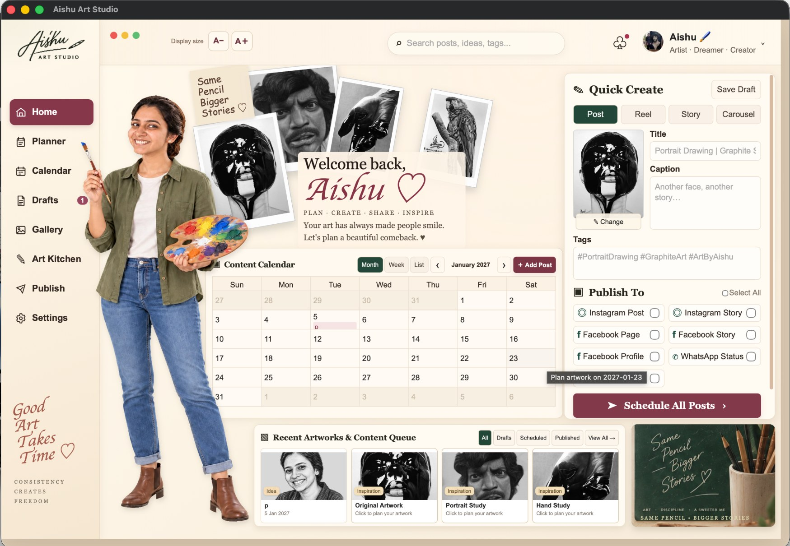
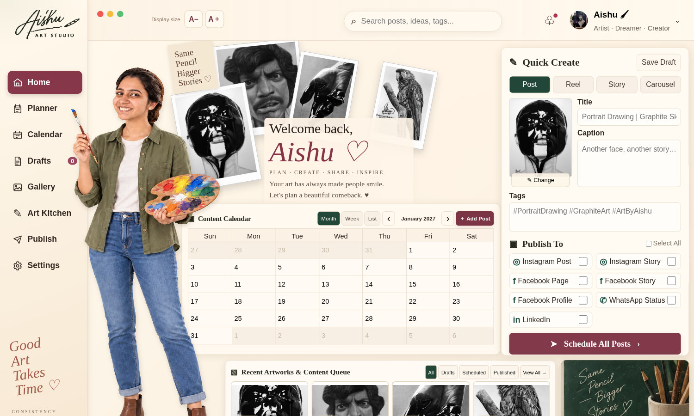
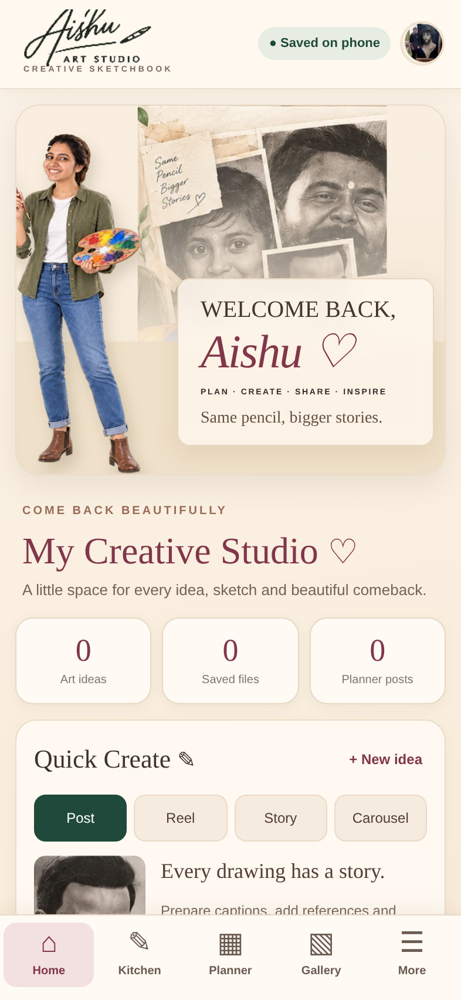
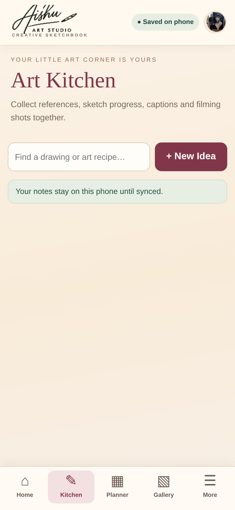
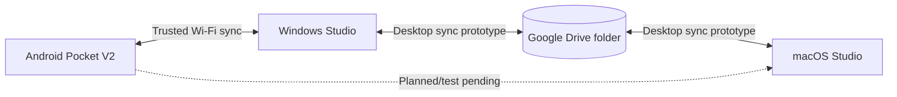

# Aishu Art Studio ✎

### A personal creative workspace — across Windows, macOS & Android

**Portfolio project · Cross-platform desktop/mobile app · Beta**

Aishu Art Studio is a personalised creative sketchbook and content-planning application for artists. It brings together reference images, drawing ideas, work-in-progress notes, captions, calendars and a curated artwork gallery — in a warm, editorial interface designed around the artist's own visual identity.

## Application Gallery

### Windows — Desktop UI Preview

### Android — Home Preview

### Android — Art Kitchen Preview

*These are UI previews rendered from the application source, not actual device screenshots.*

> **Project status:** The Windows app, native macOS app and Android Pocket V2 have been launched on real devices. Basic idea sync was tested in both directions between Windows and Android, and planner data was verified from Windows to Android. Windows ↔ Mac sync and Mac ↔ Android sync have *not yet been verified on the actual three-device setup*. Direct Android ↔ Google Drive cloud sync is not implemented.

## The idea

Art production rarely happens in just one place. Inspiration is captured on a phone, reference images are studied on a laptop, and finished work is planned and shared across platforms. Aishu Art Studio explores one private creative workspace spanning these steps, with offline-first notes and a bespoke, art-directed interface.

## Key features

- **Art Kitchen:** Drawing ideas, project stages, references, progress photos, and private notes.
- **Content Planner & Calendar:** Draft planning, dates, captions, and publishing destinations.
- **Artwork Gallery:** Visual overview of drawings and selected reference work.
- **Quick Create & Publishing Desk:** Prepare Post, Reel, Story and Carousel content; publishing is not unattended.
- **Offline Android Pocket app:** Save notes and selected images locally, even with the laptop off.
- **Local network pairing:** Transfer supported Art Kitchen updates between Android and a powered-on desktop over a trusted Wi-Fi network.
- **Desktop sync prototype:** A separate export/merge mechanism for Windows and macOS using Google Drive for desktop; full real-device verification is in progress.

## Platforms & technologies

| Platform | Implementation | Current state |
|---|---|---|
| Windows | Python desktop/local API + HTML, CSS, JavaScript | UI and basic sync tested |
| macOS | Locally packaged native `.app` wrapper around Python/web UI | App build and launch verified |
| Android | Java Android WebView + HTML/CSS/JavaScript, offline storage | APK installed; UI, data and basic sync tested |
| Shared files | Google Drive for desktop + local-first data | Desktop-to-desktop sync still needs real-device testing |

## Architecture

Android does **not** currently sync straight to Google Drive. It must reconnect to a running compatible desktop for the tested Wi-Fi workflow.

## My role & development process

**Product concept, visual direction, personal branding, workflow planning, iterative testing and AI-assisted prototyping.** This project combines an original art-focused visual identity with cross-platform implementation and real-device QA. It was developed iteratively through AI-assisted coding and hands-on testing rather than presented as a fully production-certified product.

The workflow included: Windows desktop UI → Android Pocket prototype → branded Android V2 → LAN pairing and two-way idea checks → native macOS app packaging → desktop sync prototype.

## What I learned

- Translating a spacious desktop interface into a usable mobile layout.
- Managing app packaging differences across Windows, macOS and Android.
- Distinguishing local save, Wi-Fi pairing and actual cloud synchronisation.
- Handling backups and conflicts before merging local data stores.
- Testing each platform separately rather than assuming a successful build proves feature completeness.

## Status and roadmap

- [x] Personalised Windows interface
- [x] Android branded UI and local-first storage
- [x] Native macOS application launches under its own name
- [x] Windows → Android idea and planner verification
- [x] Android → Windows idea verification
- [ ] Real-device Windows ↔ macOS sync test
- [ ] macOS ↔ Android pairing/data test
- [ ] Full image and progress-asset sync verification
- [ ] UI polish: long labels, sticky headers, date formatting
- [ ] Independent, secure cloud sync if needed
- [ ] Signed/notarised production installers and comprehensive security review

## Availability

This **initial public portfolio repository is a case study**, not a production distribution. Source files, private artwork, photographs, credentials, local backups, debug APKs and unsigned installers are intentionally not included. Release binaries can be shared later after a separate safety, permissions and packaging review.

## Project links

A video walkthrough, updated screenshots and verified installation downloads may be added to later releases.

## Usage & rights

The app identity, original artwork, photographs and graphical assets are not licensed for reuse. Please ask permission before redistributing project materials. No open-source license has been granted to code in this showcase-only repository.
